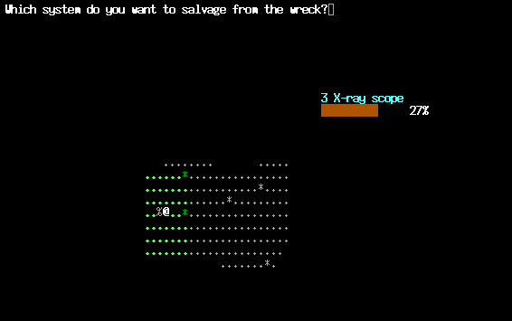
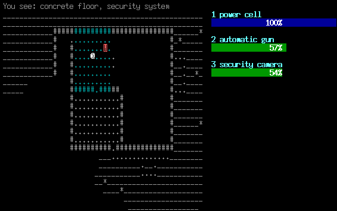
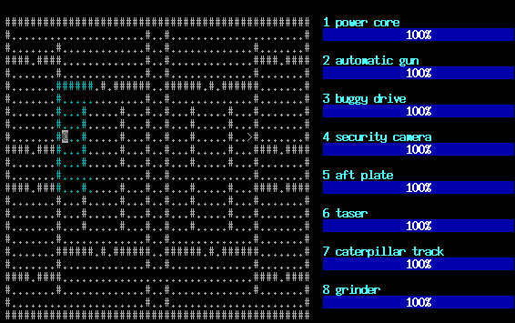

# Scrap, the Roguelike

Scrap is a roguelike game written in ten days in 2006 by Thijs van Ommen. Like
many other roguelikes it uses a simple ASCII display to show the map, and you
control a robot, represented by `@`. The world is populated by hostile enemy
robots which will try to destroy you, represented by various characters.



*Just defeated a sentry; its X-ray scope will enable my robot to look through walls.*



*Looking at the security system inside some enemy building.*



*A symmetrical level. :-)*

Each robot consists of a number of systems — power cells, weapons, propulsion,
sensors and armour. When a robot is hit, its systems are damaged. At 50% a
system stops functioning until repaired; at 0% it is damaged beyond repair. If
your power cell is destroyed it explodes and you lose. Do the same to an enemy
and it becomes a wreck you can salvage systems from, plugging them into your own
robot to make yourself stronger.

This repository is the **Extended 10DRL 1.1** release of 15 November 2006,
recovered from the Internet Archive after the original site disappeared.

## Playing

The game needs a terminal of at least 80×25.

| Key | Action |
| --- | --- |
| arrows / `hjklyubn` | move (and move into enemies to attack) |
| `1`–`8` | activate the system bound to that key |
| `d` | details of your systems, or of a robot you are looking at |
| `s` | switch a system on or off |
| `r` | rebind which system sits on which `1`–`8` key (costs no game time) |
| `S` / `R` | save / restore — a save can be restored only once, by design |
| `?` | key list |
| `Q` | quit |

`manual.txt` explains the mechanics in full, and `readme.txt` is the original
release readme.

## Building

Linux / other ncurses systems:

```sh
make -f makefile.linux
./scrap
```

Windows (MinGW cross-compile):

```sh
make -f makefile.mingw
```

You need `g++` and the ncurses development headers (`libncurses-dev` on
Debian/Ubuntu, `ncurses-devel` on Fedora). A prebuilt 2006 Windows binary is in
`archive/scrap-1.1-win32.zip` (needs the `curses.dll` shipped beside it).

The 2006 sources predate the C++ standard library tightening up its headers;
building with a modern compiler needed `#include <cstring>` adding to the four
files that use `strcpy`/`strcat`. Nothing else was changed — the game logic is
byte-for-byte the 2006 release. The unmodified release tarball is kept in
`archive/`.

## What is in here

```
*.cpp *.h        the Extended 10DRL 1.1 source, as released
makefile.*       original build files
readme.txt       original release readme
manual.txt       original game manual
COPYING          GNU General Public License, version 2
screenshots/     the three screenshots from the original homepage
archive/         the releases exactly as downloaded from the Wayback Machine
legacy/10drl/    the original Ten-Day Roguelike source (23 October 2006)
legacy/x10drl/   the first Extended 10DRL source (26 October 2006)
docs/            provenance notes
```

## Provenance

The original homepage lived at
`http://www.math.leidenuniv.nl/~mommen/scrap/` and is gone. Everything here was
recovered from the Wayback Machine capture of 24 May 2013
(<https://web.archive.org/web/20130524032130/http://www.math.leidenuniv.nl/~mommen/scrap/>),
with the file payloads served from the 18 June 2013 capture. Checksums, capture
URLs and fidelity notes are in [docs/PROVENANCE.md](docs/PROVENANCE.md).

The author later published the game himself at
<https://github.com/thijsvanommen/scrap>; that is the upstream project and the
place to send bug reports and patches. This repository is an archival mirror
that also happens to build on a current toolchain.

## Licence

Scrap is free software: you can redistribute it and/or modify it under the terms
of the **GNU General Public License, version 2 or (at your option) any later
version**. It is distributed in the hope that it will be useful, but WITHOUT ANY
WARRANTY; without even the implied warranty of MERCHANTABILITY or FITNESS FOR A
PARTICULAR PURPOSE. See [COPYING](COPYING) for the full text.

The 2006 tarballs carried no licence file; the GPL grant comes from the author's
own publication of the game, and the copyright/licence header at the top of each
source file is his. Copyright 2005, 2006 Thijs van Ommen.

One file is not GPL: `mt19937ar.h` is the Mersenne Twister reference
implementation by Makoto Matsumoto and Takuji Nishimura, used for the game's
random numbers. It is under the **BSD 3-Clause** licence, stated in full at the
top of that file. In short, it permits use, modification and redistribution in
source and binary form provided that (1) the copyright notice, conditions and
disclaimer are retained in source redistributions, (2) they are reproduced in
the documentation of binary redistributions, and (3) the names of the authors
and contributors are not used to endorse or promote derived products without
specific prior written permission. It comes with no warranty. That BSD grant
covers `mt19937ar.h` alone and is compatible with the GPL-2.0-or-later terms the
rest of the game is under.

## Credits

Scrap was written by Thijs van Ommen. The original homepage, releases and
screenshots are his; this repository only puts them back online.
